  <a href="https://rakeshbabugajula.github.io/my_portfolio/">
    <picture>
      <source media="(prefers-color-scheme: dark)" srcset="./github-profile-banner/output/dark.svg">
      <source media="(prefers-color-scheme: light)" srcset="./github-profile-banner/output/light.svg">
      
    </picture>
  </a>

  

  
  
  

  
  
  
  
  
  

---

### 👨‍💻 Executive Summary

I am a **Software Engineer and AI/ML Engineer** pursuing a **B.Tech in Computer Science and Engineering at Guru Nanak Institutions Technical Campus (GNITC, 2023–2027)**, passionate about building **scalable software platforms**, **intelligent AI applications**, and **autonomous multi-agent systems**.

- 🎓 **Selected for Premier Cohorts**: Trainee at **IIT Patna Vishlesan i-Hub** (Machine Learning & Agentic Systems) and shortlisted for **Amazon ML Summer School 2026** (Top 23% nationwide from 134,421+ applicants).
- 🚀 **15+ Production & Open-Source Projects**: Spanning Agentic AI (LangGraph, ChromaDB, Gemini, OpenAI), Computer Vision (YOLOv8, OpenCV), and Full-Stack Systems (React, Next.js, Node.js, FastAPI, PostgreSQL, MongoDB).
- 💼 **Professional Internship Experience**: Proven industry delivery at **IBM SkillsBuild** (Deep Learning NLP) and **Viswam.AI / Swecha** (Multilingual Speech AI & LLM integration).
- 💡 **Engineering Philosophy**: Delivering scalable, resilient full-stack architectures and low-latency AI pipelines designed for real-world production.

 

### 🌐 Connect Directly With Me:

  
  
  
  
  

 

---

## 📊 Live GitHub Telemetry & Developer Metrics

  
  
  

---

## 🛠️ Technical Arsenal & Core Competencies

<table>
  <tr>
    <td width="22%"><b>Core Languages</b></td>
    <td>
      
      
      
      
      
      
      
      
    </td>
  </tr>
  <tr>
    <td><b>AI / ML &amp; Agentic AI</b></td>
    <td>
      
      
      
      
      
      
      
      
      
      
      
      
    </td>
  </tr>
  <tr>
    <td><b>Backend &amp; Distributed APIs</b></td>
    <td>
      
      
      
      
      
      
      
    </td>
  </tr>
  <tr>
    <td><b>Frontend &amp; UI Architecture</b></td>
    <td>
      
      
      
      
      
      
    </td>
  </tr>
  <tr>
    <td><b>Databases &amp; Cloud Storage</b></td>
    <td>
      
      
      
      
      
    </td>
  </tr>
  <tr>
    <td><b>DevOps, Cloud &amp; Tools</b></td>
    <td>
      
      
      
      
      
      
    </td>
  </tr>
</table>

---

## 🚀 Complete Engineering Portfolio & Project Index

Every project below is developed, tested, and available publicly across my GitHub repositories.

---

### 🤖 1. Agentic AI, Multi-Agent Systems & LLMs

#### 🔹 [ExamIntellect – AI-Powered Proctoring, Analytics & Tutoring Platform](https://github.com/RakeshBabuGajula/Exam_Intellect)

- **The Problem**: Traditional online exam proctoring relies either on invasive human observers or rigid rule engines that produce false positives and fail to provide constructive student growth.
- **The Architecture**: Engineered a modular multi-agent platform separating real-time surveillance (**Proctor Agent**), diagnostic evaluation (**Tutor Agent**), and administrative reporting (**Communication Agent**).
- **Key Innovations**:
  - Live computer vision pipeline performing simultaneous head pose estimation, pupil gaze tracking, multi-face presence detection, and background speech audio transcription.
  - Automatically synthesizes post-exam diagnostic performance reports with personalized remediation roadmaps using Google Gemini & OpenAI LLMs.
- **Tech Stack**: `Python`, `OpenCV`, `Streamlit`, `Google Gemini API`, `OpenAI`, `SpeechRecognition`, `Plotly`, `Multi-Agent Architecture`.

#### 🔹 [Autonomous ECOS Engine – Enterprise Compliance & Operational Synchronization](https://github.com/RakeshBabuGajula)
- **The Problem**: Enterprise compliance teams struggle with manual review of thousands of daily multi-source logs, exposing sensitive data to privacy breaches.
- **The Architecture**: An autonomous agentic workflow leveraging **Google Gemini** reasoning combined with **n8n** webhook orchestration to monitor, classify, and redact unstructured data streams in real time.
- **Key Innovations**:
  - Automated zero-shot PII interception, deterministic security masking, and multi-tenant compliance dispatching.
  - Fault-tolerant API execution loops with exponential backoff and persistent PostgreSQL compliance audit trails.
- **Tech Stack**: `Google Gemini`, `n8n Orchestrator`, `Python`, `PostgreSQL`, `Agentic AI Workflows`, `REST APIs`.

#### 🔹 [AI Defect Analysis System – Multi-Agent Bug Triage & Root Cause Analysis](https://github.com/RakeshBabuGajula/AI-Defect-Analysis-System)

- **The Problem**: Engineering organizations spend hundreds of hours manually de-duplicating bug tickets, analyzing crash stack traces, and determining root causes across massive codebases.
- **The Architecture**: RAG-powered multi-agent triage system trained and indexed on historical defect datasets from Apache, Eclipse, and Mozilla.
- **Key Innovations**:
  - Semantic vector search with **ChromaDB** to instantly identify duplicate issues and retrieve historical resolution patterns.
  - Autonomous agents parse stack traces, isolate fault-inducing code components, and generate verified code remediation patches.
- **Tech Stack**: `Python`, `ChromaDB`, `Google Gemini`, `FastAPI`, `Streamlit`, `RAG`, `Multi-Agent Systems`.

#### 🔹 [LifeOS AI – Full-Stack Career Planning & Skill-Gap Optimization Platform](https://github.com/RakeshBabuGajula/LifeOS_AI)

- **The Problem**: Tech professionals and graduates lack objective, data-backed visibility into market skill deficiencies, leading to misaligned career trajectories and early burnout.
- **The Architecture**: Full-stack intelligent platform featuring an asynchronous **FastAPI** backend, **MongoDB Atlas** persistence, and a high-performance **Next.js 14** frontend.
- **Key Innovations**:
  - Algorithmic resume extraction paired with Google Gemini to identify competitive skill gaps and predict burnout risk trends.
  - Generates milestone-driven, dynamic step-by-step career roadmaps with curated technical learning modules.
- **Tech Stack**: `Next.js 14`, `TypeScript`, `FastAPI`, `MongoDB Atlas`, `Google Gemini API`, `Tailwind CSS`.

---

### 👁️ 2. Computer Vision, Robotics & Safety-Critical Engineering

#### 🔹 [AI-Driven UAV Collision & Intrusion Detection System](https://github.com/RakeshBabuGajula/AI-Driven-UAV-Collision-Intrusion-Detection-System)

- **The Problem**: Rapidly congesting commercial drone airspaces create severe risks of mid-air collisions with other UAVs, birds, and unauthorized airspace incursions.
- **The Architecture**: Real-time edge computer vision safety pipeline combining **YOLOv8** object detection with 3D trajectory calculation algorithms.
- **Key Innovations**:
  - Synthetic flight path generation and predictive vector tracking for early mid-air collision warning.
  - Dynamic geofence breach monitoring with an interactive, telemetry-rich Streamlit situational awareness dashboard.
- **Tech Stack**: `Python`, `YOLOv8`, `OpenCV`, `Streamlit`, `Spatial Geometry`, `Real-Time Telemetry`.

#### 🔹 [DOST Guardian 2.0 – Railway Digital Twin & Worker Safety Platform](https://github.com/RakeshBabuGajula/Dost-2.0-Guardian)

- **The Problem**: Trackside railway maintenance crews face deadly hazard conditions due to delayed communication and lack of synchronized train positioning.
- **The Architecture**: AI-assisted geospatial railway digital twin pairing real-time train movement telemetry with live GPS coordinates of track workers.
- **Key Innovations**:
  - Deterministic Safety Engine triggering proximity alerts and progressive audible warnings before trains enter active worker sectors.
  - Central Operations Command Center providing safety intelligence, grounded incident analytics, and full system observability.
- **Tech Stack**: `Python`, `Geospatial AI`, `Real-Time Safety Engine`, `Digital Twin Architecture`, `Streamlit`.

---

### ⚡ 3. Data Engineering, Enterprise RAG & ML Pipelines

#### 🔹 [Zepto Offline RAG Support Assistant & AI Platform](https://github.com/RakeshBabuGajula/zepto-support_assistant)

- **The Problem**: Customer support teams require instant, accurate operational retrieval without exposing sensitive company policy data to external public LLM APIs.
- **The Architecture**: Containerized enterprise offline RAG assistant built on **LangGraph** cyclical state machines and **ChromaDB** vector databases.
- **Key Innovations**:
  - Fully containerized via Docker for air-gapped, zero-leakage local deployment.
  - High-throughput asynchronous query handling via FastAPI with multi-turn conversation memory.
- **Tech Stack**: `LangGraph`, `ChromaDB`, `FastAPI`, `Docker`, `Python`, `RAG Architecture`.

#### 🔹 [Zepto Data Pipeline Analytics & Normalization Engine](https://github.com/RakeshBabuGajula/zepto-data-pipeline-analytics)

- **The Pipeline**: Automated web extraction and ETL pipeline that extracts raw multi-category catalog data, executes schema validation, cleans dirty records, and loads into a 3NF normalized SQLite database.
- **Analytics**: Features comprehensive SQL indexing and Pandas benchmarks delivering granular category analytics, inventory distributions, and pricing models.
- **Tech Stack**: `Python`, `BeautifulSoup4 / Scrapy`, `SQLite`, `Pandas`, `SQL Analytics`.

#### 🔹 [Titanic Analytics & Predictive ML Pipeline](https://github.com/RakeshBabuGajula/titanic-analytics-pipeline)

- **The Pipeline**: Industry-standard, leakage-free data science pipeline designed as an end-to-end predictive assessment.
- **Key Innovations**:
  - Implements strict isolation between training and validation folds to eliminate target leakage.
  - Evaluates Logistic Regression, Random Forest, and Gradient Boosting classifiers; handles class imbalance via cost-sensitive learning and grid-search hyperparameter tuning.
- **Tech Stack**: `Jupyter Notebook`, `Python`, `Scikit-Learn`, `Pandas`, `NumPy`, `Seaborn`.

---

### 🌐 4. Full-Stack Web, GovTech & Applied AI Platforms

#### 🔹 [Abhi's SeatSure – Smart Bus Booking & Flexi-Ticket Platform](https://github.com/RakeshBabuGajula/abhi-seat-sure)

- **The Problem**: Rigid bus ticket cancellation policies lead to high user dissatisfaction, lost revenue for operators, and empty seats on popular travel routes.
- **The Architecture**: High-conversion booking platform introducing **Flexi Tickets** with integrated **ReBook** and **ReSell** options.
- **Key Innovations**:
  - Interactive seat layout selector, instant digital confirmation, and a secondary ticket exchange mechanism that minimizes financial loss for passengers.
- **Tech Stack**: `React.js`, `TypeScript`, `Tailwind CSS`, `Modern UI/UX`, `System Design`.

#### 🔹 [Govinda Marg – Smart Bus Ticketing & Queue Management System](https://github.com/RakeshBabuGajula/Govinda-Marg)

🏆 *Formally appreciated and commended by APSRTC and TTD Transport Officials*
- **The Problem**: Tens of thousands of pilgrims traveling between Tirumala and Tirupati face chaotic physical queues, paper ticket wastage, and ticketing fraud.
- **The Architecture**: Full-stack web ticketing system implementing paperless dynamic QR generation, role-based portals for commuters and conductors, and real-time validation.
- **Key Innovations**:
  - Contactless digital payments, anti-counterfeit QR pass verification, and automated passenger queue load balancing.
- **Tech Stack**: `Node.js`, `Express.js`, `MongoDB`, `JavaScript`, `HTML5/CSS3`, `QR Code Engine`.

#### 🔹 [Utpatti Flow – MERN SDLC Project Management & Kanban Suite](https://github.com/RakeshBabuGajula/Utpatti-Flow)

- **The Problem**: Fast-moving engineering teams struggle to maintain unified visibility across requirements, code sprints, and deployment milestones.
- **The Architecture**: Full-stack MERN application providing end-to-end SDLC lifecycle management with dynamic drag-and-drop Kanban boards.
- **Key Innovations**:
  - Granular role-based permissions, automated activity audit logging, and team velocity metric dashboards.
- **Tech Stack**: `React`, `Node.js`, `Express.js`, `MongoDB`, `TypeScript`, `Tailwind CSS`.

#### 🔹 [Real-Time Voice Translator & Speech AI](https://github.com/RakeshBabuGajula/real-time-voice-translator)

- **The Problem**: Cross-lingual verbal communication barriers in public utilities and multi-regional workspaces.
- **The Architecture**: Real-time web engine capturing microphone audio streams, transcribing speech to text, performing contextual neural translation via Google Gemini, and synthesizing natural speech playback.
- **Key Innovations**: Supports 50+ languages with live editable transcripts, recording controls, and audio export capabilities. Built during the Viswam.AI internship.
- **Tech Stack**: `Python`, `Google Gemini API`, `Streamlit`, `SpeechRecognition`, `gTTS`, `Audio Processing`.

#### 🔹 [Fake News Detection Engine – Deep Learning NLP Classifier](https://github.com/RakeshBabuGajula/Fake_News_Detector)

- **The Problem**: Rampant proliferation of misinformation across digital social media channels.
- **The Architecture**: Deep recurrent neural network using **Bidirectional LSTM** and word embeddings trained on multi-thousand news corpora, deployed live on **Hugging Face Spaces**.
- **Key Metrics**: Achieved **~95% validation accuracy** through rigorous text cleaning, stopword filtration, tokenization, and sequence padding. Built during the IBM SkillsBuild internship.
- **Tech Stack**: `Python`, `TensorFlow/Keras`, `LSTM`, `NLTK`, `Streamlit`, `Hugging Face Spaces`.

---

## 💼 Professional Experience & Internships

<table>
  <thead>
    <tr style="background-color: #0A161F;">
      <th align="left" width="30%">Role &amp; Organization</th>
      <th align="left" width="20%">Duration</th>
      <th align="left">Key Responsibilities &amp; Measurable Impact</th>
    </tr>
  </thead>
  <tbody>
    <tr>
      <td>
        <b>AI/ML Program Trainee</b> 
        <i>Vishlesan i-Hub, IIT Patna (with Masai)</i>
      </td>
      <td>Jan 2026 – Jun 2026</td>
      <td>
        • Selected into elite cohort focused on Machine Learning, LLMs, RAG, and Agentic AI workflows. 
        • Implemented autonomous multi-agent pipelines with LangGraph, vector stores (ChromaDB), Ollama, and Hugging Face. 
        • Engineered production-grade systems incorporating tool calling, structured memory, and security guardrails.
      </td>
    </tr>
    <tr>
      <td>
        <b>AI &amp; ML Intern</b> 
        <i>IBM SkillsBuild (Edunet Foundation &amp; AICTE)</i>
      </td>
      <td>Jan 2026 – Feb 2026</td>
      <td>
        • Engineered an end-to-end Deep Learning Fake News Detection system using LSTM architectures. 
        • Attained <b>~95% validation accuracy</b> through optimized text preprocessing, tokenization, and hyperparameter tuning. 
        • Packaged and deployed the full production application live to Hugging Face Spaces with Streamlit.
      </td>
    </tr>
    <tr>
      <td>
        <b>Summer of AI Intern</b> 
        <i>Viswam.AI (Swecha)</i>
      </td>
      <td>2025</td>
      <td>
        • Built an end-to-end real-time speech translation and AI chat assistant utilizing Google Gemini. 
        • Collected and curated multilingual Indian regional audio and text datasets to advance open-source language models.
      </td>
    </tr>
  </tbody>
</table>

---

## 🏅 Honors, Awards & Key Milestones

- 🌟 **Shortlisted for Amazon ML Summer School 2026**: Shortlisted among **31,821 candidates from 134,421+ applicants** nationwide (Top 23%).
- 🎓 **Selected for IIT Patna Vishlesan I-Hub**: Premier advanced cohort in Machine Learning, RAG, and Multi-Agent Systems.
- 🚀 **Campus Ambassador – E-Cell, IIT Bombay**: Represented Asia's premier entrepreneurship body on campus, organizing hackathons and startup awareness drives.
- 💡 **Infosys Springboard Virtual Internship 7.0**: Selected for specialized software engineering training.
- 🏅 **Elite NPTEL Certification in Java Programming**: 12-week intensive certification with Elite honors from **IIT Kharagpur**.
- ⭐ **Top 25 Creator – VibeCode Creator Program**: Recognized among the top creators for technical content and system development.
- 👏 **Official Commendation from APSRTC & TTD Officials**: Recognized for Govinda Marg's innovative queue reduction and digital bus ticketing architecture.

---

## 📫 Ready to Build? Let's Connect!

I am actively seeking **Software Engineering (SWE)**, **AI/ML Engineering**, and **Full-Stack / Backend** internships and full-time opportunities.

  
  &nbsp;&nbsp;
  
  &nbsp;&nbsp;
  
  &nbsp;&nbsp;
  

  <i>Designed and custom-engineered with precision by <b>Rakesh Babu Gajula</b> • &copy; 2026</i>

