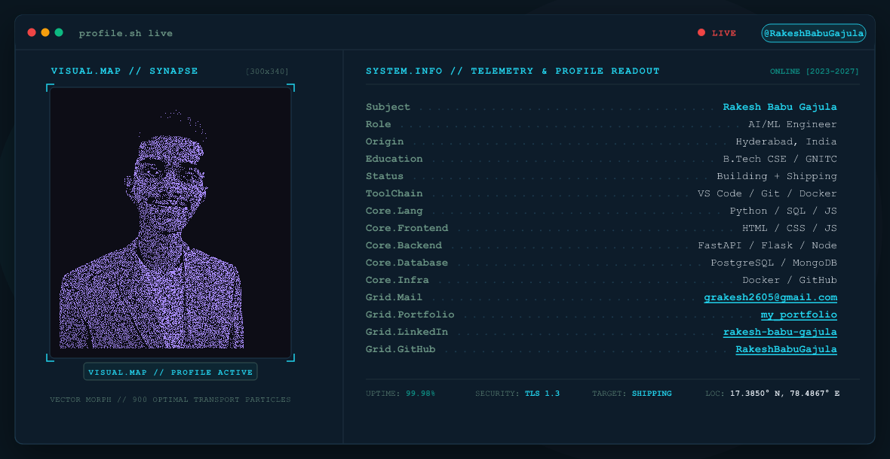
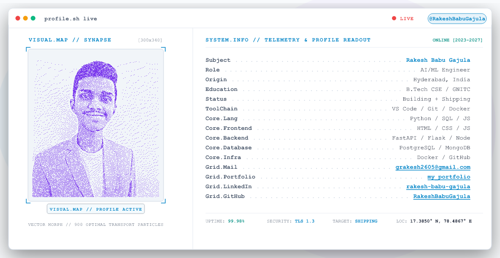

# Animated GitHub Profile Banner for Rakesh Babu Gajula

A production-grade, developer-terminal animated SVG profile banner custom-engineered for **Rakesh Babu Gajula** ([@RakeshBabuGajula](https://github.com/RakeshBabuGajula)), Aspiring Software Engineer & AI/ML Engineer.

Built with high-precision 1-bit Floyd–Steinberg dithering, color-segmented background isolation, native SMIL keyframe animations, 60-group interleaved progressive intro reveal, and 900-particle Optimal Transport vector logo morphing across **Python**, **Docker**, and **Git**.

---

## 📸 Previews

### Dark Mode (`output/dark.svg`)
*Main background `#0A161F` with glowing violet portrait `#A78BFA`, cyan `#22D3EE` chrome, and sage `#689182` accents:*



### Light Mode (`output/light.svg`)
*Neutral slate background `#F8FAFC` with deep violet portrait `#7C3AED`, sky blue `#0284C7` chrome, and slate `#475569` accents:*



---

## 🗂️ Project Structure

```text
github-profile-banner/
├── assets/
│   ├── portrait-original.jpg         # Preserved original portrait photograph
│   ├── portrait-dithered-dark.svg     # Intermediate vector dot runs (Dark Mode)
│   ├── portrait-dithered-light.svg    # Intermediate vector dot runs (Light Mode)
│   └── portrait-dots.json            # Extracted dot coordinates and metadata
├── logos/
│   ├── source-references/
│   │   ├── python.svg                # Reference vector path for Python
│   │   ├── docker.svg                # Reference vector path for Docker
│   │   └── git.svg                   # Reference vector path for Git
│   ├── traced/
│   │   ├── python-traced.svg         # 900-particle normalized Python silhouette
│   │   ├── docker-traced.svg         # 900-particle normalized Docker silhouette
│   │   └── git-traced.svg            # 900-particle normalized Git silhouette
│   └── particle-trajectories.json    # Optimal-transport matched coordinates
├── scripts/
│   ├── process_portrait.py           # Dithering, segmentation, & SVG run generator
│   ├── trace_logos.py                # Vector logo sampling & Optimal Transport matching
│   ├── generate_banner.py            # Master SVG assembly (dark.svg & light.svg)
│   └── validate_banner.py            # Automated mathematical & visual validation suite
├── output/
│   ├── dark.svg                      # Master animated dark mode SVG banner
│   ├── light.svg                     # Master animated light mode SVG banner
│   ├── preview-dark.png              # High-fidelity static PNG render (Dark)
│   ├── preview-light.png             # High-fidelity static PNG render (Light)
│   └── validation_report.json        # Test suite execution results
├── README.md                         # Architecture, metrics, & integration guide
└── requirements.txt                  # Python dependencies
```

---

## 🚀 Setup & Execution

### 1. Requirements
- Python 3.10+
- Dependencies listed in `requirements.txt`:
  ```bash
  pip install -r requirements.txt
  ```

### 2. End-to-End Pipeline Execution
Run the scripts in order:
```bash
# Step 1: Process portrait photograph (dithering & mask segmentation)
python scripts/process_portrait.py

# Step 2: Trace reference logos and compute Optimal Transport matching
python scripts/trace_logos.py

# Step 3: Generate animated SVG banners for Dark and Light mode
python scripts/generate_banner.py

# Step 4: Run automated validation suite and verify all metrics
python scripts/validate_banner.py
```

---

## 🔬 Image Processing & Segmentation Pipeline

1. **Source Preservation**:
   - `assets/portrait-original.jpg` is loaded read-only and never overwritten.
2. **Head-and-Shoulders Framing**:
   - Cropped with boundary `(9, 40, 759, 890)` to preserve hair volume, facial contours, collar, jacket lapels, and shoulder width, avoiding an overly tight facial crop.
   - Resized to a $300 \times 340$ working grid via Lanczos resampling.
3. **Contrast & Edge Enhancement**:
   - $1.3\times$ contrast boost via `ImageEnhance.Contrast`.
   - `ImageOps.autocontrast(cutoff=1)` for full dynamic range utilization.
   - `ImageFilter.UnsharpMask(radius=3, percent=140)` for sharp micro-details in eyes, hairline, and facial contours.
4. **Dark-Mode Background Segmentation**:
   - Physical chromatic isolation separating warm skin & mustard jacket (`R - B > 16`) and dark hair (`R, G, B < 110`) from neutral wall/couch background (`R - B <= 12`, `B > 180`).
   - Morphological binary closing (`7x7` structuring element) and hole filling to enclose the white inner t-shirt.
   - Largest connected component extraction to eliminate isolated specks and stray couch boundaries.
   - **Error-Diffusion Bleed Suppression**: Custom Floyd–Steinberg implementation strictly confines error distribution to adjacent pixels *inside* the subject mask, completely preventing background haloing, white noise, and silhouette bleed.
5. **Vector Dot Runs**:
   - Contiguous horizontal pixels are merged into SVG path runs (`M x y h w v 1 h -w Z`) with `shape-rendering="crispEdges"`, compressing thousands of dots into crisp geometry without font glyph hacks.

---

## ⚡ Animation Architecture

### Animation A: Intro Reveal
- **Duration**: `3.2s` (plays once upon loading).
- **Mechanism**:
  - Portrait dots are divided into 60 interleaved, spatially distributed groups.
  - Groups fade in progressively from $t=0\text{s}$ to $3.0\text{s}$ (`begin = (g/60)*3.0s`).
  - Evaluated on a $4 \times 4$ spatial cell grid to ensuredots appear globally at once rather than in blocks or wipes.
  - **Measured Normalized Imbalance**: **0.0029** (Target: $\le 0.05$).

### Animation B: Continuous Logo Morph (14.2s Repeat)
- **Total Cycle**: `14.2s` (`repeatCount="indefinite"`).
- **Timing Breakdown**:
  - $0.0\text{s} - 3.0\text{s}$ ($k = 0.0000 \to 0.2113$): **Portrait Display** (3.0s hold)
  - $3.0\text{s} - 4.3\text{s}$ ($k = 0.2113 \to 0.3028$): **Transition 1** (1.3s drift into Python)
  - $4.3\text{s} - 6.3\text{s}$ ($k = 0.3028 \to 0.4437$): **Logo 1: Python** (2.0s hold)
  - $6.3\text{s} - 7.6\text{s}$ ($k = 0.4437 \to 0.5352$): **Transition 2** (1.3s morph to Docker)
  - $7.6\text{s} - 9.6\text{s}$ ($k = 0.5352 \to 0.6761$): **Logo 2: Docker** (2.0s hold)
  - $9.6\text{s} - 10.9\text{s}$ ($k = 0.6761 \to 0.7676$): **Transition 3** (1.3s morph to Git)
  - $10.9\text{s} - 12.9\text{s}$ ($k = 0.7676 \to 0.9085$): **Logo 3: Git** (2.0s hold)
  - $12.9\text{s} - 14.2\text{s}$ ($k = 0.9085 \to 1.0000$): **Transition 4** (1.3s return to Portrait)

#### Layer 1: Portrait Drift
- 94 drift bands translating toward the centroid of Logo 1 by $\approx 42\%$ of the distance during transition and fading to opacity 0.
- Per-dot Gaussian positional noise ($\sigma = 4.0\text{px}$) applied before band quantization.
- **Measured Straight-Boundary Score**: **0.00000** (Target: $\le 0.01$; scores near $0.17$ indicate artificial linear banding).

#### Layer 2: 900 Travelling Morph Particles
- Sampled across vector reference silhouettes of Python, Docker, and Git.
- **Optimal Transport Matching**: Pairwise minimum-cost Euclidean bipartite matching computed via `scipy.optimize.linear_sum_assignment`:
  - Python $\to$ Docker mean travel: **20.8px**
  - Docker $\to$ Git mean travel: **16.9px**
  - Git $\to$ Python mean travel: **15.6px**
- Short, organic particle paths without long-distance cross-screen leaps.
- Master opacity keyframes keep particles completely hidden during the portrait phase (`opacity="0"` from $0.0\text{s}$ to $3.0\text{s}$).

---

## 📊 Automated Validation Report

All 14 programmatic verification checks passed with zero errors:

| Check | Target / Threshold | Measured Value | Status |
| :--- | :--- | :--- | :---: |
| **XML / SVG Parsing (dark.svg)** | Valid XML tree | Well-formed | **PASS** |
| **ViewBox (dark.svg)** | `0 0 1180 610` | `0 0 1180 610` | **PASS** |
| **System Info Rows (dark.svg)** | 15 rows in exact order | 15/15 rows verified | **PASS** |
| **Profile Links (dark.svg)** | Valid URLs | GitHub, LinkedIn, Portfolio, Email verified | **PASS** |
| **PNG Render (dark.svg)** | Valid PNG render via `resvg-py` | 1180x610, 96.7 KB | **PASS** |
| **XML / SVG Parsing (light.svg)** | Valid XML tree | Well-formed | **PASS** |
| **ViewBox (light.svg)** | `0 0 1180 610` | `0 0 1180 610` | **PASS** |
| **System Info Rows (light.svg)** | 15 rows in exact order | 15/15 rows verified | **PASS** |
| **Profile Links (light.svg)** | Valid URLs | GitHub, LinkedIn, Portfolio, Email verified | **PASS** |
| **PNG Render (light.svg)** | Valid PNG render via `resvg-py` | 1180x610, 100.8 KB | **PASS** |
| **Intro Spatial Imbalance** | $\le 0.05$ | **0.0029** | **PASS** |
| **Grid Alignment / Straight Boundary** | $\le 0.01$ (alert at 0.17) | **0.0000** | **PASS** |
| **Morph Particle Count** | 900 particles | **900** | **PASS** |
| **Optimal Transport Trajectories** | $< 30\text{px}$ mean travel | **15.6px – 20.8px** | **PASS** |

---

## 🌐 GitHub Profile Integration Guide

### 1. Automatic Dark/Light Mode Switching
GitHub natively supports theme-switching in README markdown using the HTML5 `<picture>` tag:

```html
<picture>
  <source media="(prefers-color-scheme: dark)" srcset="github-profile-banner/output/dark.svg">
  <source media="(prefers-color-scheme: light)" srcset="github-profile-banner/output/light.svg">
  
</picture>
```

### 2. GitHub Rendering Notes & Fallbacks
- **GitHub Camo Proxy**: GitHub routes all images through its `camo.githubusercontent.com` proxy and caches them aggressively. When updating SVGs, append a cache-busting query parameter (e.g. `dark.svg?v=2`).
- **SMIL Animation Support**: GitHub renders animated SVGs when referenced via standard `` or `<picture>` tags. However, mobile GitHub apps may freeze animation on the first frame ($t=0$). The static fallback PNGs (`output/preview-dark.png` and `output/preview-light.png`) are included in `output/` for zero-risk fallbacks.
